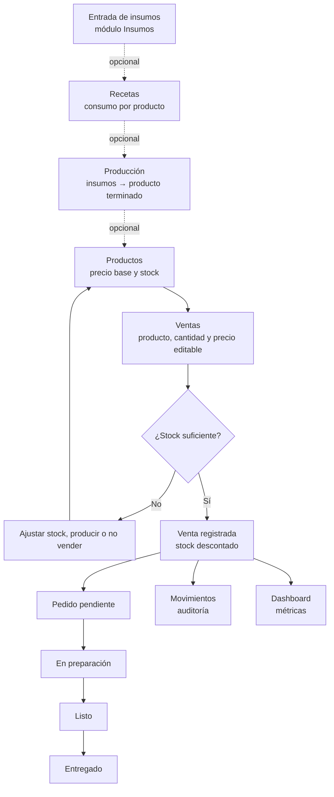
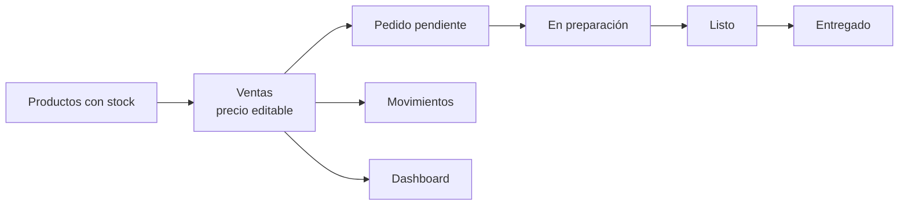

# Manual de uso — Inventario Perezosas

## 1. Idea principal

La app tiene dos modelos posibles:

- **Modelo reventa**: compras productos terminados y los vendes. Usas `Productos → Ventas → Pedidos`.
- **Modelo producción**: armas perezosas, toldos o sombrillas desde materia prima. Usas `Insumos → Recetas → Producción → Productos → Ventas → Pedidos`.

`Producción` es el eslabón que convierte insumos en stock vendible. Sin ese paso, `Insumos` y `Recetas` quedan solo como información: no aumentan el stock de productos.

## 2. Flujograma recomendado

Las líneas punteadas son opcionales: solo aplican si fabricas tus productos.

## 3. Flujo mínimo si solo revendes

## 4. ¿Se usan todos los módulos?

No. En una venta normal no intervienen todos.

| Módulo | ¿En cada venta? | Función |
|---|---:|---|
| Productos | Sí, como origen | Catálogo, precio base y stock |
| Ventas | Sí | Registra venta, permite editar precio y descuenta stock |
| Pedidos | Sí, después | Prepara y entrega la venta; no crea otra venta |
| Movimientos | Consulta | Historial de entradas, fabricación, ventas y anulaciones |
| Dashboard | Consulta | Ventas del día/mes, stock bajo y más vendidos |
| Insumos | Solo si fabricas | Materia prima |
| Recetas | Solo si fabricas o planificas | Cuánto insumo requiere cada producto |
| Producción | Solo si fabricas | Convierte insumos en producto terminado |

## 5. Manual paso a paso

### A. Preparación inicial

1. Entra con tu usuario.
2. Revisa `Productos`: ahí está el precio base y el stock disponible.
3. Solo si fabricas:
   - En `Insumos`, registra entradas de materia prima cuando falte.
   - En `Recetas`, define qué insumos y cuántas cantidades usa cada producto. Esto se hace una vez por producto.
   - En `Producción`, elige producto y cantidad. La pantalla muestra los insumos que se consumirán. Confirma solo si todos dicen `OK`.

### B. Registrar una venta

1. Ve a `Ventas`.
2. Selecciona el producto. El campo `Precio` se llena con el precio base del catálogo.
3. Ajusta la cantidad.
4. Edita el `Precio` si hay descuento, negociación o precio especial.
5. Presiona `Agregar`. Repite si llevas varios productos.
6. Puedes cambiar el precio de cada fila dentro del carrito antes de confirmar.
7. Escribe `Cliente` y `Notas` si aplica.
8. Presiona `Confirmar venta`.

Al confirmar:

- Se descuenta el stock de los productos.
- Se guarda el precio editado en esa venta.
- Se crea un `Pedido pendiente`.
- Se registra el movimiento en `Movimientos`.
- El borrador se limpia. Si cambias de sección antes de confirmar, el borrador se conserva.

### C. Gestionar el pedido

1. Ve a `Pedidos`.
2. Filtra por `Pendientes`.
3. Usa `Detalle` para ver productos, cantidades, precios y notas.
4. Avanza el estado:
   - `Tomar pedido` → `En preparación`.
   - `Marcar listo` → `Listo`.
   - `Entregar` → `Entregado`.

`Pedidos` no vuelve a registrar la venta: solo cambia el estado de la misma venta.

### D. Revisar y corregir

- En `Movimientos` puedes auditar entradas, fabricaciones, ventas, anulaciones y ajustes.
- En `Dashboard` ves ventas de hoy/mes, stock bajo y productos más vendidos.
- En `Ventas → Ventas recientes`, puedes `Anular` una venta. El stock se restaura y el pedido desaparece de la vista activa.

## 6. Reglas importantes

- El precio editado afecta solo a esa venta/pedido; no modifica el precio del catálogo.
- Anular una venta restaura el stock.
- Sin `Producción`, `Recetas` e `Insumos` no cambian el stock de productos terminados.
- Si vendes producto terminado, puedes ocultar `Insumos`, `Recetas` y `Producción` sin perder el flujo de venta.

## 7. Mejoras recomendadas

Estas son propuestas, aún no implementadas:

1. Unir `Ventas` y `Pedidos` en una sola pantalla con pestañas: `Nueva venta` y `Pedidos`.
2. En `Pedidos`, mostrar un panel de **planeación**: sumar los insumos que requieren los productos de los pedidos pendientes y compararlos con el stock disponible. Así `Recetas` e `Insumos` sí aportan aunque no ejecutes `Producción`.
3. Renombrar `Fabricar` a `Producción` y dejarlo como acción opcional desde la alerta de faltantes.
4. Si solo revendes, reemplazar `Insumos/Recetas/Producción` por una simple `Entrada de mercadería terminada`.
5. Si quieres planeación real, separar `Pedido` de `Venta`: el pedido reserva stock y la venta se confirma al entregar.
